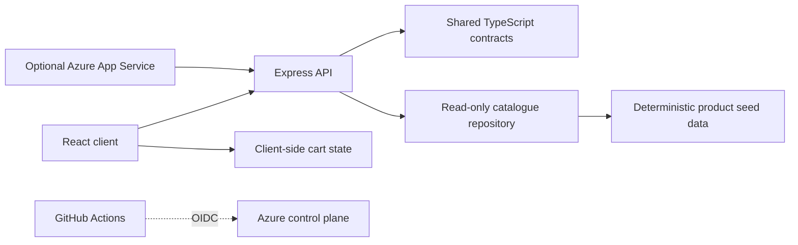
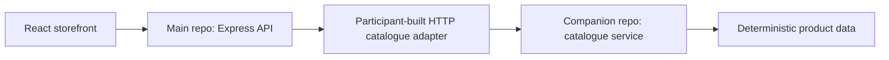

# Repository design

## Purpose

This repository is a deployable Babazon.com starter and a teaching harness for
an issue-first Agentic SDLC workshop. It optimizes for participant success in a
four-hour session while demonstrating production-oriented engineering controls.

Babazon.com is fictional and uses an original, simple visual identity. It must
not copy Amazon branding, assets, page designs, text, or trade dress.

## Design principles

### The repository and GitHub are the system of record

Durable architecture, operational instructions, validation commands, issues,
pull requests, and CI evidence are versioned or linked from the repository.
Agent conversation history is not authoritative.

### Planning is lightweight and issue-first

Material work follows this contract:

```text
parent issue -> reviewed Copilot App Plan -> bounded child issues
             -> isolated sessions/worktrees -> pull requests
             -> deterministic CI and review -> optional deployment evidence
```

The parent issue contains the user outcome and observable acceptance criteria.
Exactly four child issues record the target repository, dependencies, and
owned/prohibited paths. Children can live in different repositories; use
repository-qualified issue links. The reviewed Plan resolves shared foundations
before parallel implementation. A Copilot Project coordinates the work but does
not replace GitHub issues, the reviewed Plan, or CI as the delivery record.

### Context uses progressive disclosure

```text
AGENTS.md                  repository map and universal guardrails
DESIGN.md                  durable architecture and boundaries
docs/                      workshop and operational documentation
GitHub issues              outcome, acceptance criteria, tasks, ownership
<directory>/AGENTS.md      local rules and validation
```

### Constraints are executable

Important rules are enforced by tests, linters, workflow permissions, policy,
or structural checks. Documentation explains the rule; automation proves it.

### Humans approve intent and risk

Agents may explore, plan, implement, test, and prepare pull requests. Humans
approve the Plan, architectural and security trade-offs, merge, and deployment.

## Starting application architecture

Babazon.com is a TypeScript system with a React client and Express API. Express
serves both the API and production React bundle from one process.



Dependency direction is inward. UI and transport layers use shared contracts;
the API depends on the catalogue interface; seed data implements that
interface. Shared contracts do not depend on React, Express, or Azure SDKs.

## Workshop target: a separate catalogue service

The companion
[`babazon-catalogue-service`](https://github.com/VeVarunSharma/babazon-catalogue-service)
is a public template. Participants fork this app (or use an assigned team repo)
and create their own companion repository with **Use this template**. Both
participant repositories belong to one Copilot Project.

The companion starts with deterministic browse/detail APIs, `/health`, and
`/ready` on port 3001. Its `contracts/` directory owns the versioned HTTP
contract and examples. Search/category filtering is deliberately unfinished
there. The main app already has those shopper features using local data.

The participant outcome is to implement service-side queries and connect the
existing app through its `ProductCatalogue` interface:



The browser keeps its same-origin API; no browser-to-service CORS setup is
needed. Service mode must be explicit, validate responses, and bound requests
with a timeout. It must not silently fall back to local data. Liveness stays
independent of catalogue availability; readiness reports a service outage.
The startup product-count lookup must not prevent liveness in service mode.

Preserve current product IDs, price units, search limits, categories, cart,
checkout, and accessible states. Shared contract examples plus consumer/provider
checks prevent drift; there is no shared published package or third repository.
Integration evidence identifies both tested commits, not just branch names.
Keep completed learner solutions off the published starter branches.

## Bounded commerce domain

The starter supports:

- deterministic product catalogue and seed data;
- product search and category filtering;
- product details required by the UI;
- client-side cart additions, removals, and quantity changes;
- calculated item counts and subtotal;
- simulated checkout confirmation;
- accessible loading, empty, validation, success, and failure states;
- `/health` liveness and catalogue-backed `/ready` readiness.

Non-goals are authentication, customer accounts, real payments, external
inventory/shipping/tax services, durable orders, and production commerce.
Money is represented as integer minor units and formatted at the UI boundary.

## Repository boundaries

| Area | Responsibility |
|---|---|
| `src/shared/` | Framework-independent product and query contracts |
| `src/server/` | Express transport, injectable catalogue boundary, starter seed data, logging, and operations |
| `src/client/` | Accessible product discovery, cart, and simulated checkout |
| `tests/` | Unit, API, structural, and Playwright verification |
| `docs/labs/` | Five participant labs and the workshop wrap-up |
| `.github/` | CI, security, deployment, Copilot, issues, and review templates |
| `infra/` | Optional generic Azure App Service and monitoring composition |
| Companion repository | Browse/detail starter, service-owned HTTP contract, and participant service-side queries |

## Delivery gates and evidence

| Workflow | Responsibility |
|---|---|
| `ci.yml` | Lint, type-check, unit/API/UI tests, build, browser QA, and smoke checks |
| `codeql.yml` | Code scanning where visibility and licensing permit |
| `dependency-review.yml` | Dependency change review where available |
| `infra-validate.yml` | Bicep validation and Azure what-if through OIDC |
| `deploy.yml` | Optional protected deployment and live catalogue verification |
| `failed-test-explainer.md` and generated lock | Bounded CI failure triage with an evidence-linked issue and regression-test suggestions |

Workflows default to read-only permissions. Azure authentication uses GitHub
OIDC and protected environments. Licensed or preview controls must be reported
as unavailable rather than represented as equivalent local checks.

## Workshop constraints

- The four-hour participant path uses the GitHub Copilot App as the primary
  interface.
- Participants try Copilot Fusion before implementation and use a Copilot
  Project across both repositories. Projects is public preview; capability
  gaps must be explicit.
- Product search and category filtering across the service boundary are the
  shared feature path, not a rewrite of the already-working shopper UI.
- Fleet is used only after shared foundations and non-overlapping ownership are
  reviewed.
- Focused tests should return actionable results within two minutes.
- Every lab has a happy path, recovery checkpoint, and optional stretch task.
- Azure deployment remains advanced/instructor material and is not required to
  complete the participant path.
- Lab 5 uses GA GitHub Agentic Workflows for QA triage, not a security-remediation
  exercise. Ordinary scanners and review/deployment gates remain in place.

## Final workshop outcome

Each team leaves a GitHub-visible chain from a parent Babazon outcome issue,
through a reviewed Plan and four bounded task issues across two repositories,
to pull requests with deterministic CI and review evidence. A bounded GH-AW
turns a failed QA run into actionable evidence without approving or merging
code. Optional advanced work may add a protected Azure deployment and evidence
review, but local application and browser QA completion does not depend on cloud
access.
