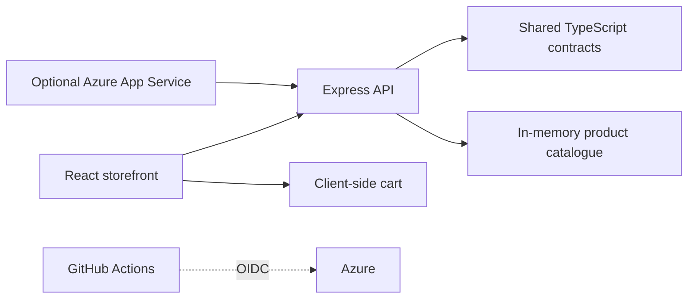

# Repository design

## Purpose

Babazon is a fictional React and Express storefront for an Agentic SDLC
workshop. The required labs use this repository through a Copilot App Session.
No companion service or Project setup is required.

Use an original visual identity. Do not copy Amazon branding, assets, text,
page designs, or trade dress.

## Native SDD workflow

Use the App's built-in experience with Copilot Fusion:

1. Interactive: inspect the code and agree on behavior and acceptance criteria.
2. Plan: review the specification and tasks in the Plan canvas; request changes.
3. Autopilot or Interactive: implement after approval, then inspect the result.

This is the workshop's approach to spec-driven development. The App's native
Plan and skills are sufficient; do not add a separate SDD framework or planning
directory. Mode selection does not override tool permissions.

Follow [AGENTS.md](AGENTS.md): one parent outcome, a reviewed Plan, and exactly
four bounded children with dependencies and owned/prohibited paths. Record
approved intent and results on issues and PRs. Chat claims alone are not evidence.
Humans approve the Plan, architectural risks, merge, and deployment.

## Application

Express serves the API and production client bundle from one process.
Shared contracts depend on no UI, transport, or cloud framework.

The starter provides deterministic products, search/category filters, product
details, cart quantities/totals, and simulated checkout. Money uses integer
minor units. Keep accessible loading, empty, validation, success, and error states.
`/health` is liveness; `/ready` checks catalogue availability.

Authentication, real payments, external shipping/inventory, durable orders,
and production commerce are outside the required labs.

## Guided feature: product sorting

Learners add price low-to-high/high-to-low sorting while preserving search,
category filters, product identity, cart, and checkout. They decide the default,
equal-price ordering, and reset behavior in Lab 1, then test those decisions.
The published starter must not contain the completed exercise.

| Learner task | Owned area | Depends on |
|---|---|---|
| 1. Sorting contract | `src/shared/`, contract tests; no sorting implementation | None |
| 2. Catalogue/API | `src/server/`, catalogue/API tests; no shared or UI edits | 1 |
| 3. Sort control | `src/client/`, client tests; no shared or server edits | 1 |
| 4. Integration | Browser checks and evidence; fix only reviewed integration defects | 2, 3 |

One main Session coordinates the work. Use separate worktrees/sessions for
parallel edits and keep ownership disjoint. Lab 4's no-store/HEAD change is a
separate operational follow-up.

## Repository map

| Path | Responsibility |
|---|---|
| `src/shared/` | Product/query contracts |
| `src/server/` | API, catalogue/seed data, logging, operations |
| `src/client/` | Storefront, cart, simulated checkout |
| `tests/` | Unit, API, documentation, and browser checks |
| `docs/labs/` | Five core labs followed by the optional capstone |
| `docs/assets/` | Workshop artwork |
| `.github/` | CI, security, deployment, agent guidance, issue/PR forms |
| `scripts/` | Instructor preparation and preflight |
| `infra/` | Optional Azure App Service and monitoring |

## Checks and boundaries

`npm run check` runs lint, types, unit/API tests, build, and browser QA.
Participant checks must accept completed learner work; starter-only guards
belong in instructor preparation.

CI, CodeQL, dependency review, and optional deployment remain independent
evidence. Workflows default to read-only access. Azure uses Verified Modules,
OIDC, and protected environments. Do not weaken these controls.

Lab 5 uses GA Agentic Workflows to explain failed QA runs, with one issue output,
deduplication, and no agent code edits or merges. Report missing access honestly.

Every lab has a recovery step. Azure is optional; the capstone is for fast
finishers and does not block the main workshop.
