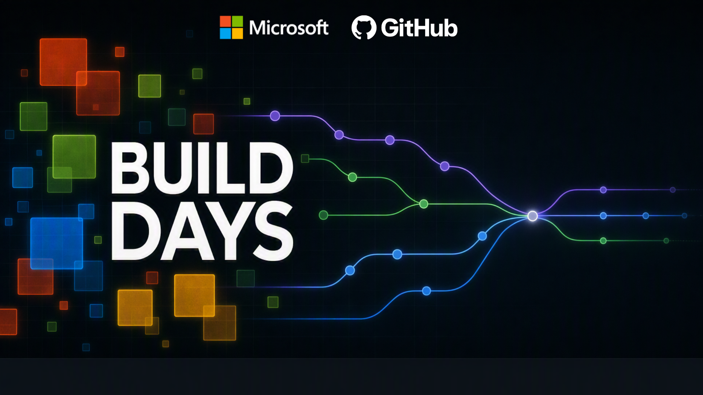

# Build Days: Agentic SDLC

Build a feature in Babazon, a fictional storefront, using the GitHub Copilot
App. You'll plan the work, coordinate agents, review changes, and automate QA.

**[Start Lab 1: SDD with the GitHub Copilot App](docs/labs/01-outcome-and-plan.md)**

## Labs

Follow these in order. Each lab says where to work and what to check.

| Lab | Where you'll work |
|---|---|
| [1. SDD with the GitHub Copilot App](docs/labs/01-outcome-and-plan.md) | Repository Session, Fusion, Plan canvas |
| [2. Multi-agent orchestration](docs/labs/02-multi-agent-orchestration.md) | Main Session and agents in the same repo |
| [3. Build, test, deploy](docs/labs/03-build-test-deploy.md) | Terminal, browser, CI; optional Azure deployment |
| [4. Cloud agent](docs/labs/04-cloud-agent.md) | GitHub issue and pull request |
| [5. Agentic workflows](docs/labs/05-gh-aw.md) | Workflow Markdown and GitHub Actions |
| [Optional capstone: build your own](docs/labs/optional-capstone.md) | Your own app feature, workflow, or use case |

## Open your repo in a Session

> [!IMPORTANT]
> Use **Sessions**, not **Projects**, for this workshop. You need one repository.

1. Fork this repo or use your assigned copy. In the Copilot App sidebar,
   select **Sessions > +**.
2. Under **Start session in**, choose your repo. If needed, use **Add GitHub
   repository**, **Clone repository**, or **Open local folder** first.
3. Choose **This computer** and **New worktree**. Select **Interactive** and
   **Copilot Fusion**, with Fusion High if available.
4. Start the Session. Ask Copilot to open `README.md` in the file editor.
   Use this Session for file editing and side-panel canvases, including your
   plan, terminal, and browser preview. Available canvases depend on your setup.

Type `/` to see available commands. `/plan` and `/autopilot` change modes;
`/orchestrate` invokes a built-in skill. Mode selection does not override tool
permissions. Use `@` to add files and `#` to reference issues in your prompt.

## Before Lab 1

Install Git, Node.js >=20.19, npm, GitHub CLI, and the Copilot App. Sign in,
enable Issues and Actions in your copy, and run:

```powershell
npm ci
npx playwright install chromium firefox webkit
npm run check
```

Labs 1-3 add **price sorting** while preserving the existing search and category
filters. Read [AGENTS.md](AGENTS.md) for workflow rules and [DESIGN.md](DESIGN.md)
for the starter's boundaries. No second repo or SDD framework is needed.

Before Lab 5, confirm your account's permitted Copilot inference/billing path
and install the pinned tooling:

```powershell
gh extension install github/gh-aw --pin v1.0.1 --force
gh aw version
```

Do not add long-lived credentials. Record unavailable features honestly.
A forecast with no sampled runs means unknown cost, not free execution.

<details>
<summary>Instructor preparation</summary>

Use the approved starter SHA from the workshop's delivery issue before learner
edits. Replace the placeholders and review the dry-run before omitting `-DryRun`:

```powershell
.\scripts\prepare-team-repo.ps1 `
  -Organization YOUR-OWNER -Repository YOUR-REPO `
  -TemplateRepository VeVarunSharma/build-days-agentic-sdlc `
  -TemplateRevision SOURCE_SHA `
  -TeamSize 2 -TeamId team01 -Confirmation PREPARE -DryRun

.\scripts\verify-env.ps1 `
  -Repository YOUR-OWNER/YOUR-REPO -ExpectedRevision SOURCE_SHA
```

Preparation checks the fresh starter and seeds the sorting and Cloud agent
issues. Those starter-only checks do not belong in learner CI. App sign-in,
Session, Plan canvas, and Fusion checks are manual.

Azure is optional. Add `-IncludeAzure` only with the assigned scope/OIDC settings;
see [infra/README.md](infra/README.md). Bash preflight has equivalent arguments.
</details>

## References

- [App Sessions and modes](https://docs.github.com/en/copilot/how-tos/github-copilot-app/agent-sessions)
  and [built-in skills](https://docs.github.com/en/copilot/reference/github-copilot-app-reference/built-in-skills).
- [Copilot Fusion](https://docs.github.com/en/copilot/concepts/models/copilot-fusion),
  [HydraFusion background](https://github.blog/ai-and-ml/github-copilot/project-hydrafusion-frontier-quality-via-multi-model-orchestration/),
  and [Copilot Benchmarks](https://benchmarks.github.com/). Compare methodology,
  quality, and cost; one workshop result is not a benchmark.
- [Agentic Workflows GA](https://github.blog/changelog/2026-10-28-github-agentic-workflows-generally-available/)
  and [setup guide](https://github.github.com/gh-aw/setup/quick-start/).

Babazon is fictional. Do not copy Amazon branding, assets, text, or trade dress.
